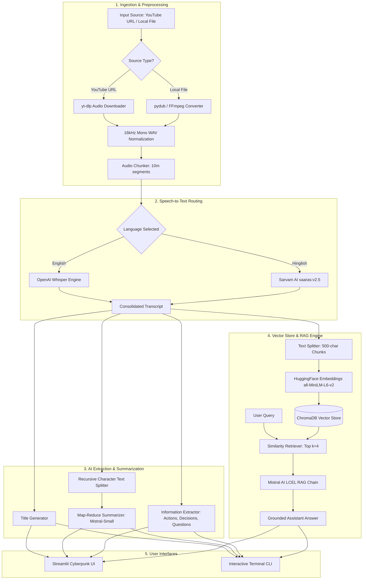

<div align="center">

# 🎬 VidQuery
### *Intelligent Video & Meeting Intelligence Assistant*

[](https://www.python.org/)
[](https://streamlit.io/)
[](https://python.langchain.com/)
[](https://mistral.ai/)
[](https://github.com/openai/whisper)
[](https://www.trychroma.com/)

<p align="center">
  <b>Transform long videos and meetings into executive summaries, structured action items, key decisions, and an interactive conversational assistant.</b>
</p>

[Key Features](#-key-features) •
[Architecture](#-system-architecture) •
[Tech Stack](#-tech-stack) •
[Prerequisites](#-prerequisites) •
[Getting Started](#-getting-started) •
[Configuration](#-configuration) •
[Project Structure](#-project-structure)

</div>

---

## 📌 Overview

**VidQuery** is an end-to-end meeting intelligence platform powered by LangChain, OpenAI Whisper, Sarvam AI, ChromaDB, and Mistral AI. Whether analyzing a YouTube lecture, conference talk, client briefing, or a local meeting recording (in English or Hinglish), VidQuery automates the entire lifecycle:

1. **Audio Acquisition & Processing:** Downloads YouTube audio directly or converts local video/audio files to standardized 16kHz mono WAV chunks.
2. **Dual-Engine Speech-to-Text:** Routes English audio to local **OpenAI Whisper** and Hinglish audio to **Sarvam AI (`saaras:v2.5`)** with automatic English translation.
3. **Map-Reduce Summarization:** Distills hours of transcripts into concise, bulleted executive summaries using a hierarchical LangChain LCEL pipeline.
4. **Structured Insights Extraction:** Identifies assigned action items (with owners & deadlines), key decisions made, and unresolved questions.
5. **Interactive RAG Chat:** Allows users to query their meeting transcript directly with source-grounded answers powered by ChromaDB vector search and Mistral AI.
6. **Modern Dark UI & CLI:** Includes a custom-styled Streamlit application with live pipeline status indicators and a lightweight terminal CLI.

---

## ✨ Key Features

- **🎥 Universal Media Ingestion**
  - Seamless YouTube URL downloading with `yt-dlp`.
  - Local video & audio file support (MP4, MKV, MOV, MP3, WAV, etc.) via `pydub` and `ffmpeg`.

- **🎙️ Dual-Engine Transcription**
  - **Local Whisper STT:** Completely private, local speech-to-text processing for English (configurable model size: `tiny`, `base`, `small`, `medium`, `large`).
  - **Sarvam AI Integration:** Cloud STT & translation tailored for Indian accents and Hinglish audio, automatically chunked into compliant segments.

- **📑 Hierarchical Map-Reduce Summarization**
  - Overcomes LLM context limits on long recordings by chunking transcripts, generating partial summaries, and consolidating them into a unified executive report.
  - Generates short, punchy session titles (under 8 words).

- **🎯 Automated Insight Extraction**
  - **Action Items:** Outlines tasks, assigned owners, and stated deadlines.
  - **Key Decisions:** Catalogs consensus points and strategic choices.
  - **Open Questions:** Highlights unresolved queries and follow-up discussion topics.

- **💬 Context-Grounded Meeting Chat (RAG)**
  - Local vector store powered by **ChromaDB** and HuggingFace **`sentence-transformers/all-MiniLM-L6-v2`** embeddings.
  - Strict anti-hallucination prompt guardrails ensuring answers are derived strictly from the transcript.

- **🎨 Sleek Dark-Themed Web Interface**
  - Built with **Streamlit** featuring custom typography (`Syne` + `JetBrains Mono`), animated background grids, progress trackers, badges, and responsive cards.

- **💻 Flexible CLI Mode**
  - Fast, headless command-line execution for automated scripting and terminal lovers.

---

## 🏗️ System Architecture



---

## 🛠️ Tech Stack

| Layer | Technology | Purpose |
| :--- | :--- | :--- |
| **User Interface** | [Streamlit](https://streamlit.io/) | Interactive web dashboard with custom CSS theme |
| **LLM & Orchestration** | [LangChain (LCEL)](https://python.langchain.com/) | Prompt chaining, Map-Reduce summarization & RAG pipeline |
| **Language Model** | [Mistral AI](https://mistral.ai/) (`mistral-small-latest`) | Fast, cost-effective reasoning, summarization & QA |
| **Speech-to-Text** | [OpenAI Whisper](https://github.com/openai/whisper) | Local, GPU/CPU-accelerated speech recognition |
| **Multilingual STT** | [Sarvam AI](https://www.sarvam.ai/) (`saaras:v2.5`) | Indic / Hinglish speech recognition and translation |
| **Embeddings** | [HuggingFace](https://huggingface.co/) (`all-MiniLM-L6-v2`) | Lightweight, high-performance dense semantic embeddings |
| **Vector Database** | [ChromaDB](https://www.trychroma.com/) | Persistent local vector store for semantic search |
| **Audio Processing** | [yt-dlp](https://github.com/yt-dlp/yt-dlp), [pydub](https://github.com/jiaaro/pydub), [FFmpeg](https://ffmpeg.org/) | Media acquisition, conversion, normalization & chunking |

---

## 📋 Prerequisites

Before running VidQuery, ensure your system meets the following requirements:

1. **Python 3.10 or higher** installed.
2. **FFmpeg binary** installed and added to your system `PATH`.
   - **Windows:**
     ```powershell
     winget install "FFmpeg (Essentials Build)"
     # or via Chocolatey
     choco install ffmpeg
     ```
   - **macOS:**
     ```bash
     brew install ffmpeg
     ```
   - **Linux (Ubuntu/Debian):**
     ```bash
     sudo apt update && sudo apt install ffmpeg -y
     ```
3. **API Keys:**
   - **Mistral AI API Key** (Required): Sign up at [console.mistral.ai](https://console.mistral.ai/).
   - **Sarvam AI API Key** (Optional, required only for Hinglish mode): Sign up at [sarvam.ai](https://www.sarvam.ai/).

---

## 🚀 Getting Started

### 1. Clone the Repository

```bash
git clone https://github.com/smithaherkar/VidQuery.git
cd VidQuery
```

### 2. Set Up a Virtual Environment

- **On Windows (PowerShell):**
  ```powershell
  python -m venv .venv
  .venv\Scripts\Activate.ps1
  ```
- **On macOS / Linux:**
  ```bash
  python3 -m venv .venv
  source .venv/bin/activate
  ```

### 3. Install Dependencies

```bash
pip install --upgrade pip
pip install -r requirements.txt
```

> [!NOTE]
> If you have a CUDA-enabled GPU and want to run Whisper with GPU acceleration, ensure you install the CUDA build of PyTorch following the official instructions at [pytorch.org](https://pytorch.org/get-started/locally/).

### 4. Configure Environment Variables

Create your `.env` file from the provided example template:

```bash
# Windows PowerShell
Copy-Item .env.example .env

# macOS / Linux
cp .env.example .env
```

Open `.env` in your text editor and add your API keys:

```env
# Required for Summaries, Action Items & RAG Chat
MISTRAL_API_KEY=your_mistral_api_key_here

# Required ONLY if using Hinglish transcription
SARVAM_API_KEY=your_sarvam_api_key_here

# Optional: tiny, base, small, medium, large (default: small)
WHISPER_MODEL=small

# Optional: Sarvam STT model (default: saaras:v2.5)
SARVAM_STT_MODEL=saaras:v2.5
```

---

## 🖥️ Running the Application

### Option A: Streamlit Web UI (Recommended)

Launch the modern web application:

```bash
streamlit run app.py
```

Once running, navigate to `http://localhost:8501` in your browser:
1. Paste a **YouTube URL** or a **local file path** (e.g. `C:\recordings\meeting.mp4`).
2. Select your language (`english` or `hinglish`).
3. Click **⚡ Analyse** and observe real-time progress indicators in the sidebar.
4. Review the generated Title, Executive Summary, Transcript, Action Items, Key Decisions, and Open Questions.
5. Ask context-grounded questions in the **Chat with your Meeting** section!

### Option B: Terminal CLI

Run the full pipeline directly in your terminal:

```bash
python main.py
```

Follow the interactive prompts to enter the media path and query the meeting via interactive chat.

### Option C: Automated Verification Test

Run the quick end-to-end integration test:

```bash
python test.py
```

---

## ⚙️ Configuration Reference

| Variable | Type | Default | Required? | Description |
| :--- | :--- | :--- | :--- | :--- |
| `MISTRAL_API_KEY` | String | *None* | **Yes** | Authentication key for Mistral AI LLM endpoints |
| `SARVAM_API_KEY` | String | *None* | Optional | Authentication key for Sarvam AI speech translation |
| `WHISPER_MODEL` | String | `small` | Optional | Local Whisper model size (`tiny`, `base`, `small`, `medium`, `large`) |
| `SARVAM_STT_MODEL`| String | `saaras:v2.5` | Optional | Sarvam Speech-to-Text model version |

---

## 📂 Project Structure

```text
VidQuery/
├── .env.example              # Environment variables template
├── .gitignore                # Ignored paths (models, downloads, cache, venv)
├── app.py                    # Streamlit web application with custom dark theme
├── main.py                   # Terminal CLI entry point and interactive REPL
├── requirements.txt          # Python dependencies
├── test.py                   # Integration test script for pipeline verification
│
├── core/                     # Core AI and RAG pipeline modules
│   ├── extractor.py          # Action items, key decisions, and question extraction
│   ├── rag_engine.py         # LCEL RAG prompt and execution chain
│   ├── summarizer.py         # Map-Reduce transcript summarizer & title generator
│   ├── transcriber.py        # Dual STT router (Whisper & Sarvam AI)
│   └── vector_store.py       # ChromaDB vector store builder & similarity retriever
│
└── utils/                    # Media handling utilities
    └── audio_processor.py    # yt-dlp downloader, WAV normalization & audio chunker
```

---

## 🔬 How It Works

### 1. Robust Audio Pipeline
Long meeting recordings often cause memory overflows or exceed API payload limits. VidQuery mitigates this by converting all audio to 16kHz mono WAV format and dividing it into manageable 10-minute chunks for local Whisper transcription, or 25-second segments with safety margins for Sarvam's synchronous STT API.

### 2. Map-Reduce Summarization
Meeting transcripts often exceed typical context windows. VidQuery employs LangChain's Map-Reduce pattern:
- **Map Phase:** Transcripts are split into 3,000-character chunks (with 200-character overlap) and summarized independently.
- **Reduce Phase:** Partial summaries are synthesized by Mistral AI into a structured, executive-level summary highlighting critical discussion points.

### 3. Precision RAG (Retrieval-Augmented Generation)
- Transcripts are split into small 500-character chunks with a 50-character overlap to retain semantic boundaries.
- Chunks are vectorized using `sentence-transformers/all-MiniLM-L6-v2` and stored in a local persistent Chroma database.
- When you ask a question, the top 4 most relevant chunks are retrieved and fed to Mistral AI with strict context-only instructions to prevent hallucinations.

---


<div align="center">
  <sub>Built with ❤️ by <a href="https://github.com/smithaherkar">Smith Aherkar</a></sub>
</div>
