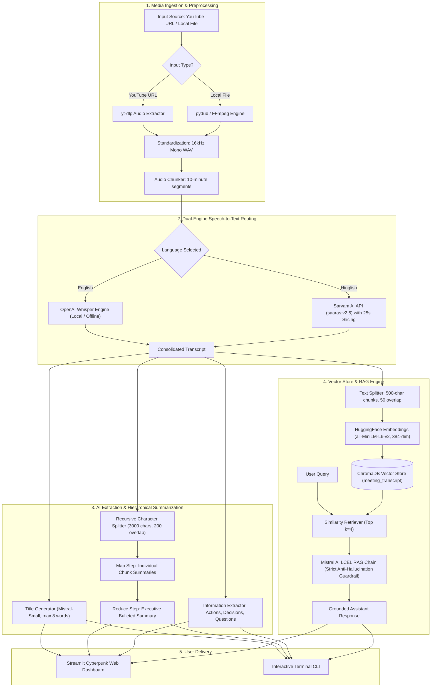

<div align="center">

# 🎬 VidQuery
### *Enterprise Meeting Intelligence & Video Understanding Assistant*

[](https://www.python.org/)
[](https://streamlit.io/)
[](https://python.langchain.com/)
[](https://mistral.ai/)
[](https://github.com/openai/whisper)
[](https://www.trychroma.com/)
[](LICENSE)

<p align="center">
  <b>Transform multi-hour video and meeting recordings into structured executive summaries, prioritized action items, key decisions, and an interactive context-grounded conversational assistant.</b>
</p>

[Overview](#-overview) •
[Architecture](#-system-architecture) •
[Key Engineering Highlights](#-key-engineering-highlights) •
[Tech Stack](#-tech-stack) •
[Core Features](#-core-features) •
[Quickstart](#-quickstart--installation) •
[Project Structure](#-project-structure) •
[Resume Highlights](#-resume-highlights-for-recruiters) •
[Author](#-author--contact)

</div>

---

## 📌 Overview

**VidQuery** is an end-to-end meeting intelligence platform engineered with **LangChain (LCEL)**, **OpenAI Whisper**, **Sarvam AI**, **ChromaDB**, and **Mistral AI**. 

In fast-paced enterprise environments, cross-functional teams lose dozens of productive hours reviewing video recordings, town halls, webinars, and technical design meetings. Moreover, international and Indian corporate calls frequently feature bilingual code-switching between Hindi and English (**"Hinglish"**), causing conventional monolingual speech-to-text engines to fail.

VidQuery addresses this challenge with:
1. **Adaptive Media Processing:** Ingests YouTube URLs or local media files (`.mp4`, `.mkv`, `.mov`, `.mp3`, `.wav`) and normalizes audio to 16kHz mono WAV streams.
2. **Dual-Engine STT Routing:** Automatically routes standard English speech to local **OpenAI Whisper** (offline, private, zero API cost) and Indic/Hinglish speech to **Sarvam AI (`saaras:v2.5`)** with real-time translation into English.
3. **Map-Reduce Summarization:** Overcomes LLM context window boundaries and "Lost-in-the-Middle" attention dilution by hierarchically chunking transcripts, running parallel map summaries, and reducing them into an executive briefing.
4. **Structured Decision & Task Extraction:** Automatically extracts action items (with assigned owners and deadlines), agreed consensus decisions, and open follow-up questions.
5. **Context-Grounded Conversational RAG:** A high-precision Retrieval-Augmented Generation pipeline using HuggingFace **`all-MiniLM-L6-v2`** embeddings and **ChromaDB** with strict anti-hallucination prompt guardrails.
6. **Modern Dark UI & CLI:** An interactive Streamlit interface featuring a cyberpunk-inspired dark theme, live pipeline stage trackers, and chat history, accompanied by a headless terminal CLI.

---

## 🏗️ System Architecture



---

## 💡 Key Engineering Highlights

### 1. Dual-Engine STT Architecture (Cost vs. Capability Optimization)
- **Local Whisper (`whisper-small`):** Runs locally on CPU/GPU via PyTorch for English recordings. Provides 100% private, offline transcription with zero cloud API costs.
- **Sarvam AI (`saaras:v2.5`):** Solves code-mixed Indic speech and regional Indian accents. Transcribes and translates Hinglish dialogue into standardized English text.

### 2. Solving Cloud STT Payload Limits (Dynamic Micro-Chunking)
- **The Challenge:** Sarvam AI’s synchronous speech translation endpoint strictly enforces a 30-second audio payload ceiling.
- **The Solution:** Built a dynamic windowing algorithm that divides 10-minute audio chunks into **25-second micro-pieces** (with a 5-second safety margin), dispatches them with automated headers, concatenates results, and guarantees disk cleanup of temporary files in a `finally` block.

### 3. Scalable Map-Reduce Summarization Pipeline
- **The Challenge:** Feeding long meeting transcripts (15,000+ tokens) into standard single-prompt LLM chains causes attention degradation ("Lost-in-the-Middle" effect) and token limit truncation.
- **The Solution:** Implemented a two-stage Map-Reduce pattern in LangChain LCEL:
  - **Map Phase:** Transcripts are split into 3,000-character segments (200-char overlap) and summarized independently.
  - **Reduce Phase:** Intermediate summaries are aggregated and synthesized into an executive bullet-point report.

### 4. Hallucination-Resistant Meeting RAG
- **Chunking Strategy:** 500-character chunks with 50-character overlap for high semantic density.
- **Embeddings & Vector Store:** `sentence-transformers/all-MiniLM-L6-v2` produces compact 384-dimensional dense vectors stored locally in **ChromaDB**.
- **Negative Prompt Constraint:** The system prompt explicitly enforces context adherence:
  > *"Answer based ONLY on the meeting transcript context provided below. If the answer is not found in the context, say: 'I could not find this information in the meeting transcript.'"*

### 5. Python 3.13 Standard Library Deprecation Engineering
- **The Challenge:** Python 3.13 deprecated the built-in C-extension module `audioop` (PEP 594), breaking core dependencies like `pydub`.
- **The Solution:** Integrated `audioop-lts` to deliver clean backwards-compatibility across Python 3.13+ environments without degrading audio processing speeds.

---

## 🛠️ Tech Stack

| Category | Technologies | Purpose |
| :--- | :--- | :--- |
| **Language** | Python 3.10+ (tested on Python 3.13) | Core runtime for backend, AI chains, and UI |
| **LLM & Orchestration** | LangChain (LCEL), Mistral AI (`mistral-small-latest`) | Declarative prompt chains, Map-Reduce summarization, RAG QA |
| **Speech Recognition** | OpenAI Whisper, Sarvam AI (`saaras:v2.5`) | Hybrid local offline & Indic cloud speech-to-text with translation |
| **Vector Database** | ChromaDB (`langchain-chroma`) | In-process, disk-persistent vector storage |
| **Embedding Model** | HuggingFace `sentence-transformers/all-MiniLM-L6-v2` | Fast, lightweight 384-dimensional semantic dense embeddings |
| **Media & Audio** | `yt-dlp`, `pydub`, `FFmpeg`, `audioop-lts` | Media acquisition, 16kHz mono normalization, segment chunking |
| **Frontend** | Streamlit | Custom reactive dashboard with CSS dark theme and chat |
| **Development Tools** | Git, PowerShell, Python Virtual Environments (`venv`) | Version control and environment isolation |

---

## ✨ Core Features

- 🎥 **Universal Input:** Seamlessly ingest YouTube URLs or local media files (`.mp4`, `.mkv`, `.mov`, `.mp3`, `.wav`).
- 🎙️ **Bilingual Speech Routing:** Switch between native English (local Whisper) and Hinglish (Sarvam AI translation).
- 🏷️ **AI Title Generator:** Formulates punchy, executive meeting titles ($\le$ 8 words) using the initial transcript context.
- 📋 **Executive Summaries:** Generates concise, bulleted summaries consolidating hours of discussion.
- ✅ **Action Item Extraction:** Categorizes every task with assigned **Owner**, **Task Description**, and **Deadline**.
- 🔑 **Key Decision Tracking:** Catalogs strategic decisions and consensus points reached by stakeholders.
- ❓ **Open Question Detection:** Isolates unresolved queries and topics marked for future follow-up.
- 💬 **Grounded Meeting Chat (RAG):** Ask arbitrary questions about the meeting and receive verified, hallucination-free answers.
- 🎨 **Modern Dark Web UI:** Custom styling (`Syne` and `JetBrains Mono` typography), live pipeline progress indicators, and responsive chat bubbles.
- 💻 **Headless Terminal CLI:** Fully interactive command-line interface (`main.py`) for automated scripting and terminal users.

---

## 🚀 Quickstart & Installation

### 1. Prerequisites
- **Python 3.10 or higher** installed.
- **FFmpeg** installed and accessible on system `PATH`:
  - **Windows:** `winget install "FFmpeg (Essentials Build)"` or `choco install ffmpeg`
  - **macOS:** `brew install ffmpeg`
  - **Linux:** `sudo apt install ffmpeg`

### 2. Clone & Setup Virtual Environment
```bash
git clone https://github.com/smithaherkar/VidQuery.git
cd VidQuery

# Set up virtual environment
python -m venv .venv

# Activate environment (Windows)
.\.venv\Scripts\Activate.ps1
# Activate environment (macOS / Linux)
source .venv/bin/activate
```

### 3. Install Dependencies
```bash
pip install --upgrade pip
pip install -r requirements.txt
pip install audioop-lts langchain-chroma
```

### 4. Configure Environment Variables
Copy `.env.example` to `.env`:
```bash
cp .env.example .env     # macOS / Linux
Copy-Item .env.example .env  # Windows PowerShell
```

Edit `.env` with your API credentials:
```env
# Required for Summaries, Action Items & RAG Chat
MISTRAL_API_KEY=your_mistral_api_key_here

# Required ONLY for Hinglish transcription & translation
SARVAM_API_KEY=your_sarvam_api_key_here

# Optional model configurations
WHISPER_MODEL=small
SARVAM_STT_MODEL=saaras:v2.5
```

### 5. Launch the Application

#### Option A: Streamlit Web UI (Recommended)
```bash
streamlit run app.py
```
Open **`http://localhost:8501`** in your browser.

#### Option B: Terminal CLI
```bash
python main.py
```

#### Option C: Automated Verification Test
```bash
python test.py
```

---

## 📂 Project Structure

```text
VidQuery/
├── .env.example              # Environment variables template
├── .gitignore                # Git ignore rules (virtualenvs, downloads, vector db)
├── README.md                 # Project documentation & recruiter briefing
├── app.py                    # Streamlit web UI (CSS dark theme, status tracking, chat)
├── main.py                   # Terminal CLI runner and interactive REPL loop
├── requirements.txt          # Python dependencies
├── test.py                   # End-to-end integration test script
│
├── core/                     # AI Orchestration and RAG modules
│   ├── extractor.py          # Action items, key decisions, and questions extraction
│   ├── rag_engine.py         # LCEL RAG prompt chain & conversational QA
│   ├── summarizer.py         # Map-Reduce transcript summarizer & title generator
│   ├── transcriber.py        # Dual STT router (Whisper local + Sarvam AI REST API)
│   └── vector_store.py       # ChromaDB vector store builder & similarity retriever
│
└── utils/                    # Media handling utilities
    └── audio_processor.py    # yt-dlp downloader, 16kHz WAV normalization & 10m chunker
```

---

## 💼 Resume Highlights (For Recruiters)

If you are a recruiter or hiring manager reviewing this project, here are the key competencies demonstrated:

- **End-to-End GenAI Architecture:** Designed and implemented a complete multi-modal AI workflow from raw audio ingestion to downstream RAG chat using LangChain Expression Language (LCEL).
- **Hybrid Speech-to-Text Engineering:** Routed multi-accented speech across local Whisper and cloud Sarvam AI, solving cold-start API limits with custom 25-second windowing.
- **Large Context Handling (Map-Reduce):** Implemented hierarchical summarization over long-form transcripts to overcome context window saturation and prevent attention loss.
- **Production-Conscious RAG:** Engineered a lightweight, CPU-efficient vector retrieval pipeline using ChromaDB and `all-MiniLM-L6-v2` with strict anti-hallucination guardrails.
- **Modern Full-Stack Python Delivery:** Built both a responsive, modern dark-themed web interface in Streamlit and a headless terminal CLI.

### Sample Resume Bullets:
```text
• Engineered "VidQuery", an enterprise meeting intelligence assistant ingesting YouTube and local recordings into structured action items, executive summaries, and interactive RAG chat.
• Architected a dual-engine STT router combining local OpenAI Whisper for offline English audio with Sarvam AI for bilingual Hinglish speech recognition and English translation.
• Implemented a LangChain LCEL Map-Reduce summarization pipeline chunking long transcripts into 3,000-character segments to eliminate context window truncation and attention degradation.
• Built a local vector search engine using ChromaDB and all-MiniLM-L6-v2 embeddings, achieving sub-20ms similarity retrieval with strict anti-hallucination guardrails.
```

---

## 👤 Author & Contact

**Smith Aherkar**
- **GitHub:** [@smithaherkar](https://github.com/smithaherkar)
- **Repository:** [VidQuery](https://github.com/smithaherkar/VidQuery)
- **Portfolio / Inquiries:** smithaherkar@gmail.com

---

<div align="center">
  <sub>Built with ❤️ using LangChain, Mistral AI, Whisper, Sarvam AI, and Streamlit</sub>
</div>
